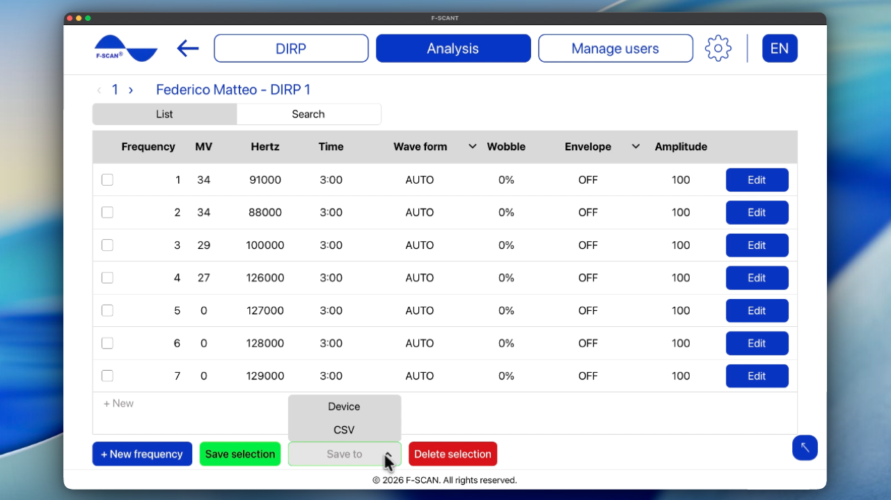

# Jak analyzovat DIRP

## Jak načíst uložené DIRP

1. Na úvodní obrazovce klikněte na **Načíst DIRP**, nebo v horní liště na **Analýza**.
2. Vyberte uživatele a poté DIRP, které chcete analyzovat.
3. Otevře se uložený graf.

Stejný graf můžete otevřít také přes **Spravovat uživatele**, **Spravovat DIRP** a poté **Načíst DIRP**.

Pokud vidíte **Vyberte uživatele** nebo **Vyberte DIRP**, ještě nic není vybráno. Vyberte uživatele a DIRP ze seznamů a pokračujte.

Video 7. Otevření Analýzy a načtení DIRP.

  <video controls preload="none" width="100%" src="/assets/videos/analysis-navigation.mp4">
  </video>
  

    <strong>Video 7.</strong> Otevření Analýzy a načtení DIRP. Sledujte online:
    <a href="https://fscant-docs.fscan.com/cs/analysis/">fscant-docs/cs/analysis/</a>
  

Na grafu **Porovnat s katalogem** a **Otevřít program** používají již uloženou **Úroveň ořezu**.

## Jak číst graf

Graf je stejný jako při živém snímání:

- **CV** (Conductivity Value): osobní základní hodnota pro analyzovaného uživatele. Pro užitečné výsledky by měla být mezi 5 % a 25 %.
- **MV** (Measured Value): síla odezvy frekvence. Zobrazuje se jako zelený sloupec — čím vyšší sloupec, tím silnější hodnota.
- **HITS:** sloupce nad čárou CLIP. Jsou to nejsilnější výsledky snímání.
- **ZOOM:** pomocí + graf vizuálně zvýšíte a pomocí − snížíte. Zvyšte jej, když jsou sloupce příliš malé, a snižte, když jsou příliš velké.
- **CLIP** / **Úroveň ořezu:** čára, která určuje, které sloupce se počítají jako **HITS**. Po dokončení snímání ji **AUTO** nastaví za vás. Pokud chcete více nebo méně HITS, posuňte čáru dolů nebo nahoru.

Šipky vedle čísla DIRP otevřou předchozí nebo následující uložené DIRP pro daného uživatele.

## Jak porovnat HITS s katalogem frekvencí

**Porovnat s katalogem** porovná vaše HITS s katalogem frekvencí uloženým ve F-SCANT. U každé položky katalogu zkontroluje, zda její frekvence leží v rozsahu shody některého z vašich HITS. Pokud ano, položka se v tabulce zobrazí jako shoda v katalogu.

Jak blízko je „dost blízko“, nastavuje **Rozsah shody ± Hz**. Obvyklý rozsah je 1000 Hz. Širší rozsah dá více shod, užší méně. Rozsah můžete změnit na obrazovce výsledků (ne v **Nastavení**).

Pro zobrazení shod:

1. Otevřete uložené **DIRP**, nebo dokončete nové.
2. Klikněte na **Porovnat s katalogem**.
3. Prohlédněte tabulku. Změňte **Rozsah shody ± Hz**, pokud chcete širší nebo užší rozsah.
4. Zvolte další postup:
    - **Uložit do** uloží tabulku CSV.
    - **Otevřít katalog frekvencí** umožní prohlížet celý katalog. Můžete hledat podle názvu a řadit od A do Z nebo podle frekvence. Vybrané řádky lze přidat do tabulky analýzy tlačítkem **Přidat do analýzy**.
    - **Uložit jako program** vytvoří a uloží program na základě vybraných řádků.

**Upozornění:** tabulka výsledků uvádí jen položky katalogu, jejichž frekvence je blízko vašim HITS. Nejde o lékařskou diagnózu.

Video 8. Porovnání HITS s katalogem a prohlížení katalogu frekvencí.

  <video controls preload="none" width="100%" src="/assets/videos/pathogens.mp4">
  </video>
  

    <strong>Video 8.</strong> Porovnání HITS s katalogem a prohlížení katalogu frekvencí. Sledujte online:
    <a href="https://fscant-docs.fscan.com/cs/analysis/">fscant-docs/cs/analysis/</a>
  

## Jak otevřít a uložit program

**Program** je seznam frekvencí převzatých z **HITS** DIRP (tvar vlny, čas, wobble, obálka a amplituda). Změna programu nemění původní graf DIRP.

1. Program otevřete jedním ze dvou způsobů: po dokončení DIRP klikněte na grafu DIRP na **Otevřít program**, nebo použijte **Spravovat program** ve **Spravovat uživatele**.
2. V případě potřeby upravte řádky. Můžete měnit **Tvar vlny**, **Čas**, **Wobble**, **Obálka** a **Amplituda**. Kliknutím na **+ Nový** přidáte řádek.
3. Klikněte na **Uložit do** a zvolte, kam uložit:
    - **CSV** uloží vybrané frekvence jako tabulkový soubor.
    - **Zařízení** odešle program do F-SCAN (**Needs F-SCAN**). F-SCANT výstup sám nespustí. Až jej chcete spustit, stiskněte na F-SCAN tlačítko START.

Obrázek 8. Seznam programu s **Uložit do** **Zařízení** a **CSV**.

