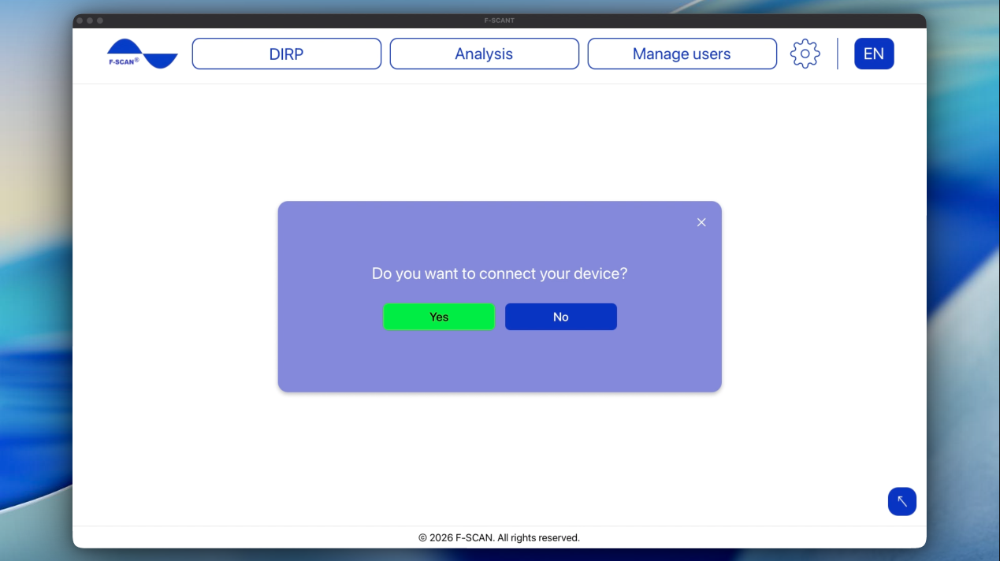
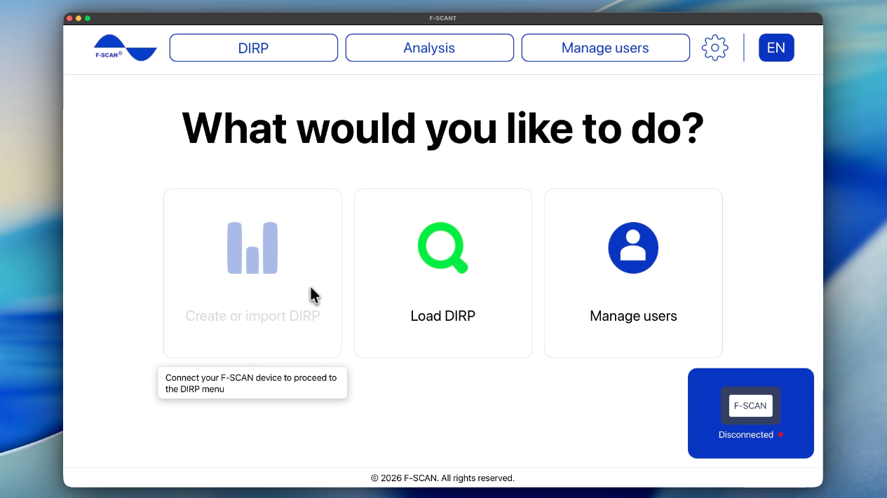
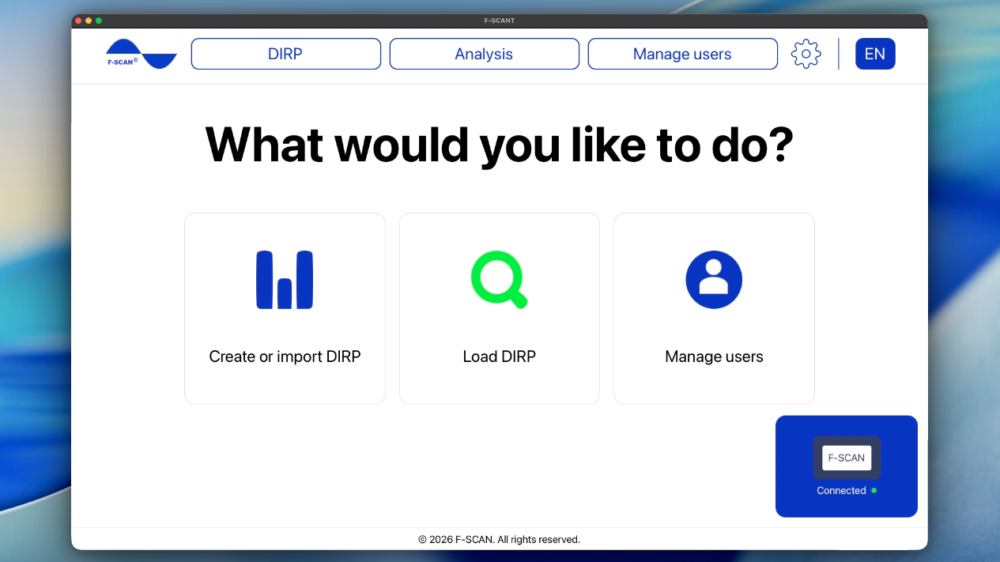

# Jak připojit F-SCAN

Po zobrazení **Vítejte v aplikaci F-SCANT!** se F-SCANT zeptá: **Chcete připojit zařízení?**

Obrázek 1. První otázka o připojení s **Ano** a **Ne**.

- **Ano** spustí kroky připojení.
- **Ne** vás přesune na úvodní obrazovku. Připojit můžete kdykoli později pomocí panelu zařízení vpravo dole.

## Připojení zařízení

**Needs F-SCAN**

Budete potřebovat:

- F-SCANT, nainstalovaný (viz [Jak nainstalovat F-SCANT](install.md))
- F-SCAN zapnutý a zobrazující úvodní obrazovku
- USB kabel
- **F-Code** z faktury F-SCANT

USB kabel zapojte přímo do USB portu počítače. Nezapojujte jej do USB hubu (malé krabičky, která z jednoho portu udělá několik), ani do dokovací stanice nebo monitoru s dalšími USB porty. Tyto doplňky často zabrání počítači rozpoznat F-SCAN.

1. Zapněte F-SCAN a nechte jej na úvodní obrazovce.
2. Zapojte USB kabel, jak je popsáno výše.
3. V softwaru F-SCANT klikněte na tlačítko **Připojit**.
4. Pokud F-SCANT zobrazí **Zadejte F-Code**, zadejte kód z faktury a klikněte na **Odeslat**.

F-Code je na faktuře F-SCANT APP. Pokud jej nemůžete najít, kontaktujte TB-Electronics.

Když panel zobrazí **Připojeno** spolu se sériovým číslem a verzí, jste hotovi. Při prvním úspěšném připojení se také zobrazí **Připojení bylo úspěšné!** a poté se otevře úvodní obrazovka.

Video 2. Připojení zařízení.

  <video controls preload="none" width="100%" src="/assets/videos/connect-device.mp4">
  </video>
  

    <strong>Video 2.</strong> Připojení zařízení. Sledujte online:
    <a href="https://fscant-docs.fscan.com/cs/connect/">fscant-docs/cs/connect/</a>
  

Na Macu jsou podrobné kroky USB ovladače v [Připojení F-SCAN na Macu](connect-mac.md).

## Pokud připojení nefunguje

Zkuste znovu **Připojit** poté, co zkontrolujete body níže.

Pokud se nic nestane, nebo panel zůstane na **Připojování…**:

- Na Macu se ujistěte, že je nainstalován a povolen ovladač Silicon Labs (viz [instalace](install.md) a [Připojení na Macu](connect-mac.md)).
- Zapojte kabel přímo do počítače, ne do hubu, doku ani monitoru (viz výše).
- F-SCAN musí být zapnutý a zobrazovat úvodní obrazovku.

Pokud vidíte **CHYBA: Byl zadán nesprávný F-Code. Zkuste to znovu!**, zadaný kód neodpovídá tomuto F-SCAN. F-SCANT kontroluje kód podle faktury k danému zařízení. Zadejte F-Code znovu z faktury. Pokud to stále selže, kontaktujte TB-Electronics.

## Panel zařízení

Panel zařízení je modrý rámeček vpravo dole na obrazovce. Vždy zobrazuje stav zařízení: připojeno nebo odpojeno. Pokud je připojeno, zobrazí se další relevantní informace:

- **Zařízení:** název připojeného zařízení F-SCAN
- **Sériové číslo:** sériové číslo F-SCAN
- **Verze:** verze F-SCAN
- **Časovač:** pokud jste na zařízení nastavili časovač, po kterém se F-SCAN automaticky vypne, zobrazí se zde. Pro ideální použití s F-SCANT doporučujeme časovač v nastavení zařízení vypnout.

Klikněte na **Odpojit**, když chcete kabel odpojit. F-SCANT se sám znovu nepřipojí, pokud jste odpojili kabel nebo vypnuli F-SCAN. Až bude zařízení znovu připravené, klikněte na **Připojit**.

Panel můžete rozbalit a sbalit pomocí bílých šipek „nahoru“ a „dolů“.

Video 3. Rozbalení a sbalení panelu zařízení.

  <video controls preload="none" width="100%" src="/assets/videos/bluebox-sizes.mp4">
  </video>
  

    <strong>Video 3.</strong> Rozbalení a sbalení panelu zařízení. Sledujte online:
    <a href="https://fscant-docs.fscan.com/cs/connect/">fscant-docs/cs/connect/</a>
  

## Úvodní obrazovka

Úvodní obrazovka nabízí tři možnosti: **Vytvořit nebo importovat DIRP**, **Načíst DIRP** a **Spravovat uživatele**.

Obrázek 2. Úvodní obrazovka, F-SCAN není připojen.

Obrázek 3. Úvodní obrazovka, F-SCAN je připojen.

