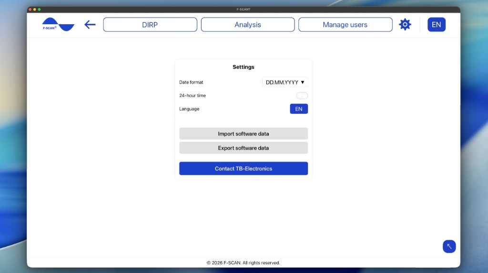

# Nastavení

Kliknutím na ozubené kolečko v horní nabídce otevřete **Nastavení**.

Obrázek 10. **Nastavení**: formát data, 24hodinový formát, jazyk, **Importovat data softwaru** a **Exportovat data softwaru**.

## Jak nastavit datum a čas

- **Formát data:** nastaví pořadí, ve kterém se data zobrazují. Zvolte **DD.MM.YYYY** (nejprve den, např. 25.10.2026), **MM.DD.YYYY** (nejprve měsíc, např. 10.25.2026), nebo **YYYY.MM.DD** (nejprve rok, např. 2026.10.25).
- **24hodinový formát:** když je zapnutý, časy se zobrazují jako 14:30. Když je vypnutý, zobrazují se jako 2:30 PM.

Tato nastavení mění pouze vzhled data a času ve F-SCANT. Nemění F-SCAN.

## Jak nastavit jazyk

**Jazyk** v **Nastavení**, nebo písmena jazyka v horní liště, mění jazyk F-SCANT.

Nabídka zobrazuje **EN**, **IT**, **DE**, **PL**, **CZ** (angličtina, italština, němčina, polština, čeština).

Výrazy jako DIRP, Hz, **Fmin**, **Fmax**, **HITS** a **CLIP** zůstávají ve všech jazycích stejné. Jména osob a názvy v katalogu frekvencí se také nepřekládají.

## Jak importovat a exportovat data softwaru

**Importovat data softwaru** načte do F-SCANT uživatele, DIRP a katalog frekvencí z jakékoli verze softwaru.

1. Klikněte na **Importovat data softwaru**.
2. Vyberte jeden nebo více souborů, nejvýše 50: zálohu F-SCANT (`.json`) nebo soubor F-SCANT3 (`.ft3`).
3. Zvolte **Přidat jen chybějící položky** nebo **Přidat vše (kopie přejmenovat)**. Položky katalogu se stejným názvem a frekvencí se nikdy neduplikují.
4. Souhrn ukáže, co bylo importováno, a vypíše soubory, které se importovat nepodařilo.

**Exportovat data softwaru** uloží uživatele, DIRP a katalog frekvencí z tohoto počítače do jednoho záložního souboru.

**Upozornění:** import na tomto počítači data přidá. Před pokračováním zkontrolujte, že máte správné soubory. Dokud něco nepřenesete, obsah uložený na F-SCAN se nemění.

## Kontaktovat TB-Electronics

**Kontaktovat TB-Electronics** otevře e-mail na info@fscan.com.
