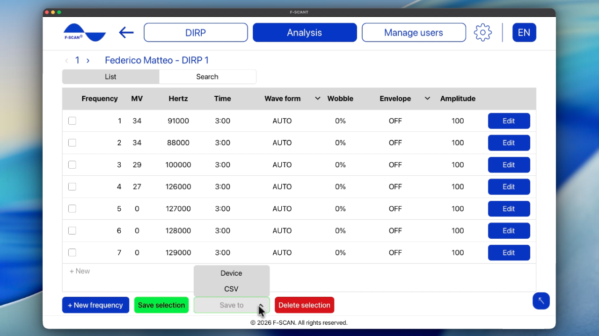

# DIRP analysieren

## Einen gespeicherten DIRP laden

1. Klicken Sie auf dem Startbildschirm auf **DIRP laden** oder in der oberen Leiste auf **Analyse**.
2. Wählen Sie den Benutzer und dann den DIRP, den Sie analysieren möchten.
3. Das gespeicherte Diagramm öffnet sich.

Sie können dasselbe Diagramm auch über **Benutzer verwalten**, **DIRP verwalten** und dann **DIRP laden** öffnen.

Wenn Sie **Bitte einen Benutzer wählen** oder **Bitte ein DIRP wählen** sehen, ist noch nichts ausgewählt. Wählen Sie einen Benutzer und einen DIRP aus den Listen und fahren Sie fort.

Video 7. Analyse öffnen und einen DIRP laden.

  <video controls preload="none" width="100%" src="/assets/videos/analysis-navigation.mp4">
  </video>
  

    <strong>Video 7.</strong> Analyse öffnen und einen DIRP laden. Online ansehen:
    <a href="https://fscant-docs.fscan.com/de/analysis/">fscant-docs/de/analysis/</a>
  

Im Diagramm nutzen **Mit Katalog abgleichen** und **Programm öffnen** das bereits gespeicherte Clipping-Level.

## Das Diagramm lesen

Das Diagramm ist dasselbe wie bei einem Live-Scan:

- **CV** (Conductivity Value): ein persönlicher Basiswert für den analysierten Benutzer. Für aussagekräftige Ergebnisse sollte er zwischen 5 % und 25 % liegen.
- **MV** (Measured Value): wie stark eine Frequenz registriert wurde. Sie erscheint als grüner Balken; je höher der Balken, desto stärker die Messung.
- **HITS:** die Balken oberhalb der CLIP-Linie. Das sind die stärksten Ergebnisse des Scans.
- **ZOOM:** mit + vergrößern Sie das Diagramm und mit − verkleinern Sie es. Vergrößern Sie es, wenn die Balken zu klein sind, und verkleinern Sie es, wenn sie zu groß sind.
- **CLIP** / **Clipping-Level:** die Linie, die entscheidet, welche Balken als **HITS** zählen. Nach dem Scan setzt **AUTO** sie für Sie. Wenn Sie mehr oder weniger HITS möchten, verschieben Sie die Linie nach unten oder oben.

Die Pfeile neben der DIRP-Nummer öffnen den vorherigen oder nächsten gespeicherten DIRP für diesen Benutzer.

## HITS mit dem Frequenzkatalog abgleichen

**Mit Katalog abgleichen** vergleicht Ihre HITS mit dem in F-SCANT gespeicherten Frequenzkatalog. Für jeden Katalogeintrag wird geprüft, ob dessen Frequenz im Trefferbereich eines Ihrer HITS liegt. Wenn ja, erscheint der Eintrag in der Tabelle als Katalogtreffer.

Was als „nah genug“ gilt, legen Sie mit **Trefferbereich ± Hz** fest. Der übliche Bereich beträgt 1000 Hz. Ein breiterer Bereich ergibt mehr Katalogtreffer, ein engerer weniger. Sie können den Bereich auf dem Ergebnisbildschirm ändern (nicht unter **Einstellungen**).

So sehen Sie die Treffer:

1. Öffnen Sie einen gespeicherten **DIRP**, oder schließen Sie einen neuen ab.
2. Klicken Sie auf **Mit Katalog abgleichen**.
3. Lesen Sie die Tabelle. Ändern Sie **Trefferbereich ± Hz**, wenn Sie einen breiteren oder engeren Bereich möchten.
4. Wählen Sie, was als Nächstes geschehen soll:
    - **Exportieren** speichert eine CSV-Tabelle.
    - **Frequenzkatalog öffnen** ermöglicht Ihnen, den vollständigen Katalog zu durchsuchen. Sie können nach Namen suchen und von A bis Z oder nach Frequenz sortieren. Ausgewählte Zeilen können Sie mit der Schaltfläche **Zur Analyse hinzufügen** zur Analysetabelle hinzufügen.
    - **Programm speichern** erstellt und speichert ein Programm auf Basis der ausgewählten Zeilen.

**Bitte beachten Sie:** Die Ergebnistabelle listet nur Katalogeinträge, deren Frequenz nahe an Ihren HITS liegt. Sie ist keine medizinische Diagnose.

Video 8. HITS mit dem Katalog abgleichen und den Frequenzkatalog durchsuchen.

  <video controls preload="none" width="100%" src="/assets/videos/pathogens.mp4">
  </video>
  

    <strong>Video 8.</strong> HITS mit dem Katalog abgleichen und den Frequenzkatalog durchsuchen. Online ansehen:
    <a href="https://fscant-docs.fscan.com/de/analysis/">fscant-docs/de/analysis/</a>
  

## Ein Programm öffnen und speichern

Ein **Programm** ist die Frequenzliste aus den **HITS** eines DIRP (Wellenform, Zeit, Wobble, Hüllkurve und Amplitude). Das Ändern eines Programms ändert nicht das ursprüngliche DIRP-Diagramm.

1. Öffnen Sie das Programm auf eine von zwei Arten: Klicken Sie nach Abschluss des DIRP im DIRP-Diagramm auf **Programm öffnen**, oder verwenden Sie **Programm verwalten** unter **Benutzer verwalten**.
2. Bearbeiten Sie die Zeilen bei Bedarf. Sie können Wellenform, Zeit, Wobble, Hüllkurve und Amplitude ändern. Klicken Sie auf **+ Neue Frequenz**, um eine Zeile hinzuzufügen.
3. Klicken Sie auf **Speichern auf** und wählen Sie den Speicherort:
    - **CSV** speichert die ausgewählten Frequenzen als Tabellendatei.
    - **Gerät** sendet das Programm an den F-SCAN (**Needs F-SCAN**). F-SCANT startet die Ausgabe nicht. Drücken Sie START am F-SCAN, wenn Sie es ausführen möchten.

Abbildung 8. Programmliste mit **Speichern auf** **Gerät** und **CSV**.

