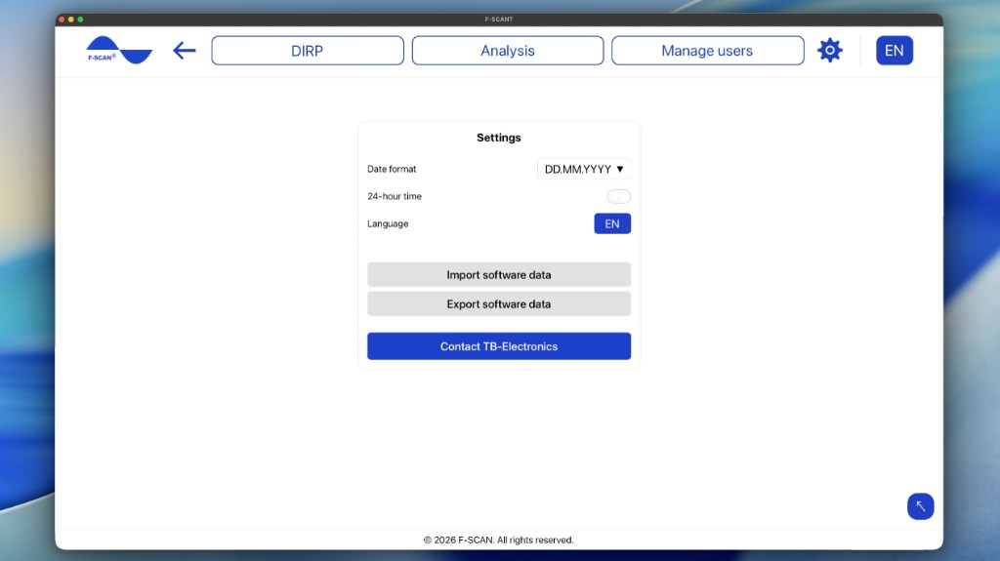

# Einstellungen

Klicken Sie auf das Zahnrad im oberen Menü, um **Einstellungen** zu öffnen.

Abbildung 10. **Einstellungen**: Datumsformat, 24-Stunden-Format, Sprache, **Softwaredaten importieren** und **Softwaredaten exportieren**.

## Datum und Uhrzeit einstellen

- **Datumsformat:** legt die Reihenfolge fest, in der Daten angezeigt werden. Wählen Sie **DD.MM.YYYY** (Tag zuerst, z. B. 25.10.2026), **MM.DD.YYYY** (Monat zuerst, z. B. 10.25.2026) oder **YYYY.MM.DD** (Jahr zuerst, z. B. 2026.10.25).
- **24-Stunden-Format:** wenn eingeschaltet, erscheinen Zeiten als 14:30. Wenn ausgeschaltet, erscheinen sie als 2:30 PM.

Diese Einstellungen ändern nur, wie Datum und Uhrzeit in F-SCANT aussehen. Am F-SCAN selbst ändern sie nichts.

## Sprache einstellen

**Sprache** unter **Einstellungen** oder die Sprachkürzel in der oberen Leiste ändern die Sprache von F-SCANT.

Das Menü zeigt **EN**, **IT**, **DE**, **PL**, **CZ** (Englisch, Italienisch, Deutsch, Polnisch, Tschechisch).

Wörter wie DIRP, Hz, **Fmin**, **Fmax**, **HITS** und **CLIP** bleiben in jeder Sprache gleich. Personennamen und die Namen im Frequenzkatalog werden ebenfalls nicht übersetzt.

## Softwaredaten importieren und exportieren

**Softwaredaten importieren** übernimmt Benutzer, DIRP und den Frequenzkatalog aus jeder Version der Software in F-SCANT.

1. Klicken Sie auf **Softwaredaten importieren**.
2. Wählen Sie eine oder mehrere Dateien, höchstens 50: eine F-SCANT-Sicherung (`.json`) oder eine F-SCANT3-Datei (`.ft3`).
3. Wählen Sie **Nur fehlende Einträge hinzufügen** oder **Alles hinzufügen (Kopien umbenennen)**. Katalogeinträge mit gleichem Namen und gleicher Frequenz werden nicht dupliziert.
4. Eine Zusammenfassung zeigt, was importiert wurde, und listet fehlgeschlagene Dateien auf.

**Softwaredaten exportieren** speichert die Benutzer, DIRP und den Frequenzkatalog dieses Computers in einer Sicherungsdatei.

**Bitte beachten Sie:** Der Import fügt Daten auf diesem Computer hinzu. Prüfen Sie vor dem Fortfahren, dass Sie die richtigen Dateien haben. Am Speicher des F-SCAN ändert sich dadurch nichts, bis Sie etwas übertragen.

## TB-Electronics kontaktieren

**TB-Electronics kontaktieren** öffnet eine E-Mail an info@fscan.com.
