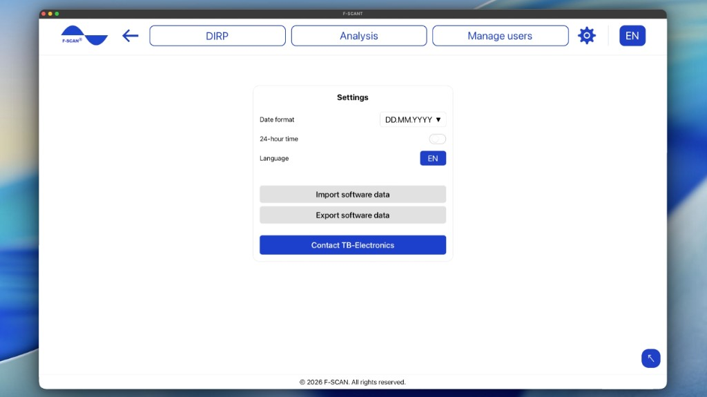

# Einstellungen

Klicken Sie auf das Zahnrad im oberen Menü, um **Einstellungen** zu öffnen.

Abbildung 10. **Einstellungen**: Datumsformat, 24-Stunden-Format, Sprache, **Softwaredaten importieren** und **Softwaredaten exportieren**.

## Datum und Uhrzeit einstellen

- **Datumsformat:** legt die Reihenfolge fest, in der Daten angezeigt werden. Wählen Sie **DD.MM.YYYY** (Tag zuerst, z. B. 25.10.2026), **MM.DD.YYYY** (Monat zuerst, z. B. 10.25.2026) oder **YYYY.MM.DD** (Jahr zuerst, z. B. 2026.10.25).
- **24-Stunden-Format:** wenn eingeschaltet, erscheinen Zeiten als 14:30. Wenn ausgeschaltet, erscheinen sie als 2:30 PM.

Diese Einstellungen ändern nur, wie Datum und Uhrzeit in F-SCANT aussehen. Am F-SCAN selbst ändern sie nichts.

## Sprache einstellen

**Sprache** unter **Einstellungen** oder die Sprachkürzel in der oberen Leiste ändern die Sprache von F-SCANT.

Das Menü zeigt **EN**, **IT**, **DE**, **PL**, **CZ** (Englisch, Italienisch, Deutsch, Polnisch, Tschechisch).

Wörter wie DIRP, Hz, **Fmin**, **Fmax**, **HITS** und **CLIP** bleiben in jeder Sprache gleich. Personennamen und die Namen im Frequenzkatalog werden ebenfalls nicht übersetzt.

## Softwaredaten importieren und exportieren

**Softwaredaten importieren** übernimmt Benutzer, DIRP und den Frequenzkatalog aus jeder Version der Software in F-SCANT.

1. Klicken Sie auf **Softwaredaten importieren**.
2. Wählen Sie eine oder mehrere Dateien, höchstens 10.000: eine F-SCANT-Sicherung (`.json`) oder eine F-SCANT3-Datei (`.ft3`).
3. Wählen Sie **Nur fehlende Einträge hinzufügen** oder **Alle Einträge hinzufügen (Duplikate umbenennen)**. Katalogeinträge mit gleichem Namen und gleicher Frequenz werden nicht dupliziert.
4. Während des Imports zeigt ein Fortschrittsbalken **Importiere … von … Dateien**, wie viele Dateien bisher erfolgreich und fehlgeschlagen sind, und eine Schätzung der verbleibenden Zeit. Große Importe können mehrere Minuten dauern.
5. Sie können während eines Imports **Abbrechen** drücken. Die gerade importierten Dateien werden noch fertiggestellt, es wird nichts Weiteres importiert, und bereits importierte Dateien bleiben auf diesem Computer. Die Zusammenfassung zeigt, wie viele Dateien vor dem Abbruch importiert wurden.
6. Eine Zusammenfassung zeigt, wie viele Benutzer erstellt oder umbenannt, wie viele DIRP erstellt oder übersprungen und wie viele Katalogeinträge erstellt, übersprungen oder aktualisiert wurden, sowie die fehlgeschlagenen Dateien. Wenn mehr als fünf Dateien fehlschlagen, speichert **Fehlerliste exportieren** die vollständige Liste mit dem Grund für jede Datei. Eine einzelne erfolgreiche Datei kann eine kürzere Bestätigung zeigen.

**Softwaredaten exportieren** speichert die Benutzer, DIRP und den Frequenzkatalog dieses Computers in einer Sicherungsdatei.

**Bitte beachten Sie:** Der Import fügt Daten auf diesem Computer hinzu. Prüfen Sie vor dem Fortfahren, dass Sie die richtigen Dateien haben. Am Speicher des F-SCAN ändert sich dadurch nichts, bis Sie etwas übertragen.

## TB-Electronics kontaktieren

**TB-Electronics kontaktieren** öffnet eine E-Mail an info@fscan.com.
