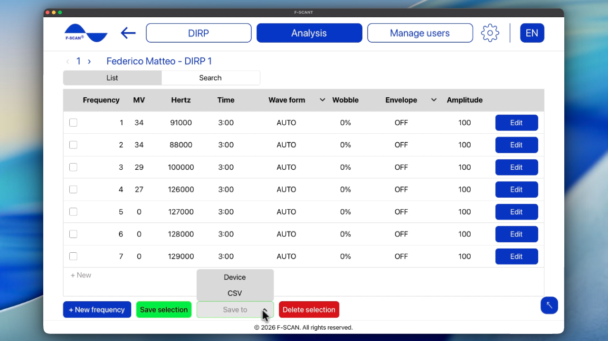

# How to analyze a DIRP

## How to load a saved DIRP

1. Click **Load DIRP** on the home screen, or **Analysis** in the top bar.
2. Select the user, and then the DIRP you want to analyze.
3. The saved chart opens.

You can open the same chart from **Manage users, Manage DIRP**, then **Load DIRP**.

If you see **Please select a user** or **Please select a DIRP**, nothing is chosen yet. Pick a user and a DIRP from the lists, then continue.

Video 7. Open Analysis and load a DIRP.

  <video controls preload="none" width="100%" src="/assets/videos/analysis-navigation.mp4">
  </video>
  

    <strong>Video 7.</strong> Open Analysis and load a DIRP. Watch online:
    <a href="https://fscant-docs.fscan.com/analysis/">fscant-docs/analysis/</a>
  

On the chart, **Match to catalog** and **Open program** use the clipping level already saved.

## How to read the chart

The chart is the same as during a live scan:

- **CV** (Conductivity Value): a personal baseline value for the user being analyzed. For useful results it should be between 5% and 25%.
- **MV** (Measured Value): how strong a frequency registered. It shows as a green bar, and the taller the bar, the stronger the reading.
- **HITS:** the bars above the CLIP line. These are the strongest results of the scan.
- **ZOOM:** use + to make the graph taller and − to make it shorter. Make it taller when the bars are too small, and shorter when they are too big.
- **CLIP** / **Clipping level:** the line that decides which bars count as **HITS**. Once the scan finishes, **AUTO** places it for you. If you want more or fewer HITS, move the line down or up.

The arrows next to the DIRP number open the previous or next saved DIRP for that user.

## How to match HITS to the frequency catalog

**Match to catalog** compares your HITS with the frequency catalog stored in F-SCANT. For each catalog entry, it checks whether its frequency is within the match range of one of your HITS. If it is, the entry appears in the table as a catalog match.

How close is “close enough” is set by **Match range ± Hz**. The usual range is 1000 Hz. A wider range gives you more catalog matches, a narrower one gives you fewer. You can change the range on the results screen (not in **Settings**).

To see the matches:

1. Open a saved **DIRP**, or finish a new one.
2. Click **Match to catalog**.
3. Read the table. Change **Match range ± Hz** if you want a wider or narrower range.
4. Choose what to do next:
    - **Save to** saves a CSV spreadsheet.
    - **Open frequency catalog** lets you browse the full catalog. You can search by name, sort from A to Z or by frequency. Selected rows can be added to the analysis table with the button **Add to analysis**.
    - **Save as program** creates and stores a program based on the rows you selected.

**Please note:** the results table only lists catalog entries whose frequency is close to your HITS. It is not a medical diagnosis.

Video 8. Match HITS to the catalog and browse the frequency catalog.

  <video controls preload="none" width="100%" src="/assets/videos/pathogens.mp4">
  </video>
  

    <strong>Video 8.</strong> Match HITS to the catalog and browse the frequency catalog. Watch online:
    <a href="https://fscant-docs.fscan.com/analysis/">fscant-docs/analysis/</a>
  

## How to open and save a program

A **program** is the list of frequencies taken from the **HITS** of a DIRP (wave form, time, wobble, envelope, and amplitude). Changing a program does not change the original DIRP graph.

1. Open the program in one of two ways: click **Open program** on the DIRP chart after DIRP is completed, or use **Manage program** in **Manage users**.
2. Edit the rows if you need to. You can change Wave form, Time, Wobble, Envelope, and Amplitude. Click **+ New** to add a row.
3. Click **Save to** and choose where to save it:
    - **CSV** saves the selected frequencies as a spreadsheet file.
    - **Device** sends the program to the F-SCAN (**Needs F-SCAN**). F-SCANT does not start the output. Press START on the F-SCAN when you want to run it.

Figure 8. Program list with **Save to** **Device** and **CSV**.

