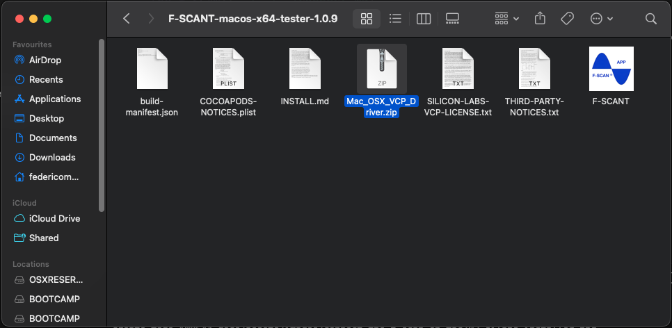
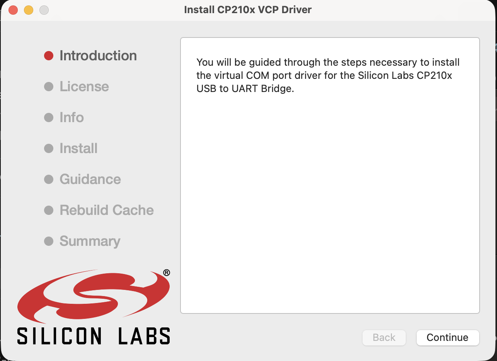

# Connect the F-SCAN on a Mac

You already have F-SCANT. These steps install the USB driver that came with it and connect the F-SCAN. The same driver file is used on an Intel Mac and an Apple Silicon Mac. You do not pick a processor, and you do not download a driver from the web.

You need:

- F-SCANT
- The F-SCAN, turned on and showing its home screen
- A USB cable (into the Mac, or a hub or a dock)
- The L-Code from your F-SCANT invoice

## 1. Install the driver included with F-SCANT

In the folder that came with F-SCANT, read **SILICON-LABS-VCP-LICENSE.txt** before you continue. Then open **Mac_OSX_VCP_Driver.zip**, open **SiLabsUSBDriverDisk.dmg**, and double-click **Install CP210x VCP Driver**.

The installer may ask for your Mac password. This is Silicon Labs CP210x VCP 6.0.3. Silicon Labs says it is for Mac OS X 10.11 and later. F-SCANT has been checked with this driver on an Intel Mac running macOS 15. That check does not cover every older or newer macOS.

Figure 4. The F-SCANT folder with the Silicon Labs installer beside the app.

Figure 5. The Silicon Labs installer.

## 2. Allow the Silicon Labs extension

macOS still asks you to allow the driver after the installer finishes. On the Mac where this was last checked:

1. Open **System Settings → General → Login Items & Extensions**.
2. Under **Extensions**, open **Driver Extensions** (it lists `com.silabs.cp210x`).
3. Turn on **CP210xVCPDriver**. Enter your Mac password if asked, then click **Done**.

A newer macOS may use a slightly different name for that panel. Use the video below.

No restart was needed on that Mac.

Video 1. Enable the Silicon Labs driver on a Mac.

  <video controls preload="none" width="100%" src="/assets/videos/driver-extension-mac-intel.mp4">
  </video>
  

    <strong>Video 1.</strong> Enable the Silicon Labs driver on a Mac. Watch online:
    <a href="https://fscant-docs.fscan.com/connect-mac/">fscant-docs/connect-mac/</a>
  

If macOS also shows a separate button to allow system software from Silicon Labs, allow it.

## 3. Plug in the F-SCAN

Turn the F-SCAN on and leave it on its home screen. Plug the USB cable into the Mac or using a hub or a dock.

## 4. Connect in F-SCANT

Open **F-SCANT**. If macOS says the developer cannot be verified, use Apple’s steps to open that app anyway: [Open Anyway](https://support.apple.com/en-us/102445). Do not turn off the security check for every app.

Click **Connect**. If F-SCANT asks for an L-Code, enter the code from your F-SCANT invoice. When the panel says **Connected** and shows a serial number and a version, you are done. The connect flow is also shown in [Video 2 on How to connect the F-SCAN](connect.md).

## If Connect does not succeed

Check these before you try again:

- The Silicon Labs extension is turned on.
- The cable is plugged into the Mac, or into a hub or a dock.
- The F-SCAN is on and showing its home screen.
- The L-Code matches the invoice.

A wrong L-Code shows **ERROR: Wrong L-Code entered. Please try again!**
