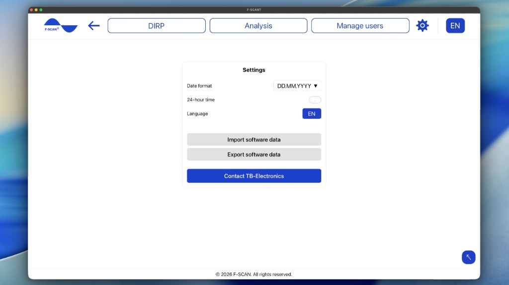

# Settings

Click the gear in the top menu to open **Settings**.

Figure 10. **Settings**: date format, 24-hour time, language, and import.

## How to set date and time

- **Date format:** sets the order in which dates are shown. Choose **DD.MM.YYYY** (day first, e.g. 25.10.2026), **MM.DD.YYYY** (month first, e.g. 10.25.2026), or **YYYY.MM.DD** (year first, e.g. 2026.10.25).
- **24-hour time:** when on, times appear as 14:30. When off, they appear as 2:30 PM.

These settings only change how dates and times look in F-SCANT. They do not change the F-SCAN.

## How to set the language

**Language** in **Settings**, or the language letters in the top bar, change the language of F-SCANT.

The menu shows **EN**, **IT**, **DE**, **PL**, **CZ** (English, Italian, German, Polish, Czech).

Words such as DIRP, Hz, **Fmin**, **Fmax**, **HITS** and **CLIP** stay as they are in every language. People’s names and the names in the frequency catalog are also not translated.

## How to import and export software data

**Import software data** brings users, DIRPs and the frequency catalog into F-SCANT from any version of the software.

1. Click **Import software data**.
2. Pick one or more files, at most 50: an F-SCANT backup (`.json`) or an F-SCANT3 file (`.ft3`).
3. Choose **Add only missing entries** or **Add everything (rename copies)**. Catalog entries with the same name and frequency are never duplicated.
4. A summary shows what was imported and lists any file that failed.

**Export software data** saves the users, DIRPs and frequency catalog on this computer to one backup file.

**Please note:** import adds data on this computer. Check that you have the correct files before you continue. Nothing stored on the F-SCAN changes until you transfer something.

## Contact TB-Electronics

**Contact TB-Electronics** opens an email to info@fscan.com.
