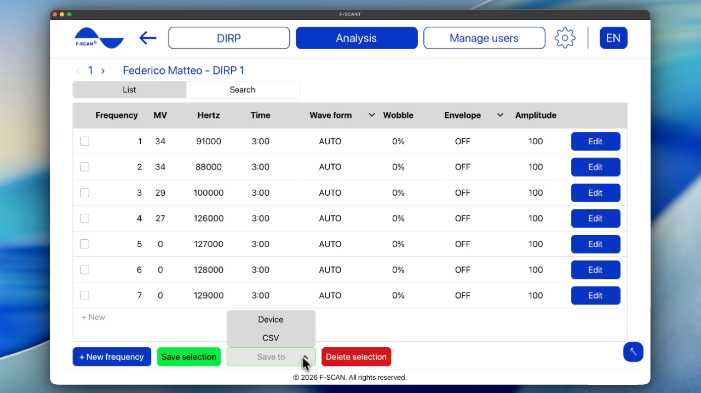

# Come analizzare un DIRP

## Come caricare un DIRP salvato

1. Fai clic su **Carica DIRP** nella schermata iniziale, oppure su **Analisi** nella barra in alto.
2. Seleziona l’utente e poi il DIRP da analizzare.
3. Si apre il grafico salvato.

Puoi aprire lo stesso grafico da **Gestisci utenti**, **Gestisci DIRP**, poi **Carica DIRP**.

Se vedi **Seleziona un utente** o **Seleziona un DIRP**, non hai ancora selezionato nulla. Scegli un utente e un DIRP dagli elenchi, poi continua.

Video 7. Aprire Analisi e caricare un DIRP.

  <video controls preload="none" width="100%" src="/assets/videos/analysis-navigation.mp4">
  </video>
  

    <strong>Video 7.</strong> Aprire Analisi e caricare un DIRP. Guarda online:
    <a href="https://fscant-docs.fscan.com/it/analysis/">fscant-docs/it/analysis/</a>
  

Sul grafico, **Abbina patogeni** e **Apri programma** usano il livello di clipping già salvato.

## Come leggere il grafico

Il grafico è lo stesso di una scansione in tempo reale:

- **CV** (Conductivity Value): un valore di riferimento personale per la persona analizzata. Per risultati utili dovrebbe essere tra 5% e 25%.
- **MV** (Measured Value): quanto è forte la risposta a una frequenza. Compare come barra verde: più è alta, più è forte la lettura.
- **HITS:** le barre sopra la linea CLIP. Sono i risultati più forti della scansione.
- **ZOOM:** usa + per rendere il grafico più alto e − per renderlo più basso. Alzalo quando le barre sono troppo piccole, abbassalo quando sono troppo grandi.
- **CLIP** / **Livello di clipping:** la linea che decide quali barre contano come **HITS**. A fine scansione, **AUTO** la posiziona per te. Se vuoi più o meno HITS, sposta la linea in basso o in alto.

Le frecce accanto al numero DIRP aprono il DIRP salvato precedente o successivo di quell’utente.

## Come abbinare i patogeni

**Abbina patogeni** confronta i tuoi HITS con l’elenco patogeni memorizzato in F-SCANT. Per ogni patogeno dell’elenco, verifica se la sua frequenza è vicina a uno dei tuoi HITS. Se lo è, il patogeno compare nella tabella come possibile corrispondenza.

Quanto deve essere “abbastanza vicino” lo definisce **Soglia ± Hz**. Di solito la finestra è di 1000 Hz. Una finestra più ampia produce più possibili corrispondenze; una più stretta ne produce meno. Puoi cambiare la finestra nella schermata dei risultati (non in **Impostazioni**).

Per vedere le corrispondenze:

1. Apri un **DIRP** salvato, oppure terminane uno nuovo.
2. Fai clic su **Abbina patogeni**.
3. Leggi la tabella. Modifica **Soglia ± Hz** se vuoi una finestra più ampia o più stretta.
4. Scegli cosa fare dopo:
    - **Esporta** salva un foglio CSV.
    - **Apri database patogeni** permette di sfogliare l’elenco completo. Puoi cercare per patogeno, ordinare dalla A alla Z o per frequenza. Le righe selezionate si possono aggiungere alla tabella di analisi con il pulsante **Aggiungi all’analisi**.
    - **Salva programma** crea e memorizza un programma basato sulle righe selezionate.

**Nota:** la tabella patogeni è solo un confronto con l’elenco memorizzato. Non è una diagnosi medica.

Video 8. Abbinare patogeni e sfogliare il database patogeni.

  <video controls preload="none" width="100%" src="/assets/videos/pathogens.mp4">
  </video>
  

    <strong>Video 8.</strong> Abbinare patogeni e sfogliare il database patogeni. Guarda online:
    <a href="https://fscant-docs.fscan.com/it/analysis/">fscant-docs/it/analysis/</a>
  

## Come aprire e salvare un programma

Un **programma** è l’elenco di frequenze ricavato dagli **HITS** di un DIRP (forma d’onda, tempo, wobble, inviluppo e ampiezza). Modificare un programma non modifica il grafico DIRP originale.

1. Apri il programma in uno di due modi: fai clic su **Apri programma** sul grafico DIRP dopo che il DIRP è completato, oppure usa **Gestisci programma** in **Gestisci utenti**.
2. Modifica le righe se serve. Puoi cambiare Forma d’onda, Tempo, Wobble, Inviluppo e Ampiezza. Fai clic su **+ Nuova frequenza** per aggiungere una riga.
3. Fai clic su **Salva su** e scegli dove salvarlo:
    - **CSV** salva le frequenze selezionate come foglio di calcolo.
    - **Dispositivo** invia il programma all’F-SCAN (**Needs F-SCAN**). F-SCANT non avvia l’uscita. Premi START sull’F-SCAN quando vuoi eseguirlo.

Figura 8. Elenco programmi con **Salva su** **Dispositivo** e **CSV**.

