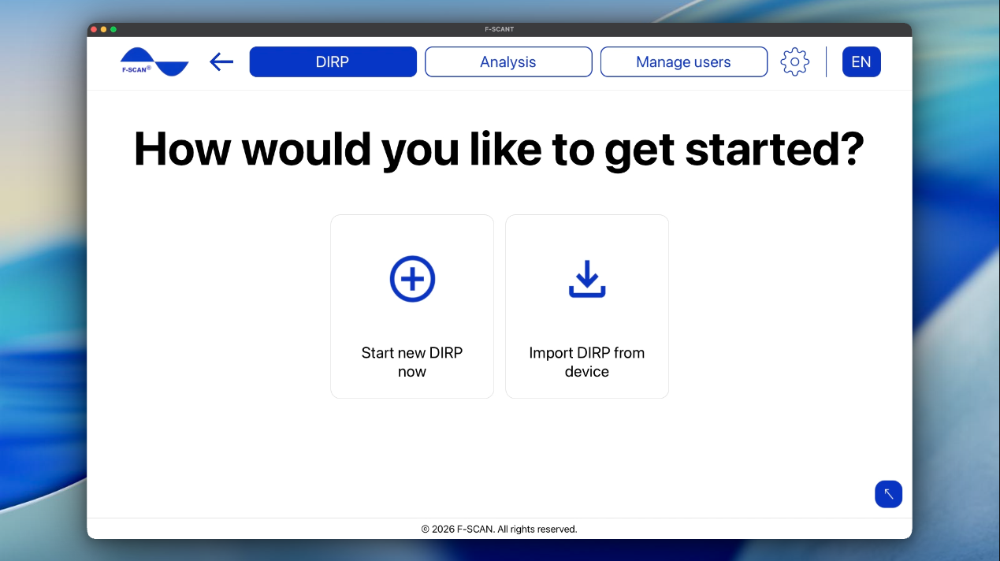
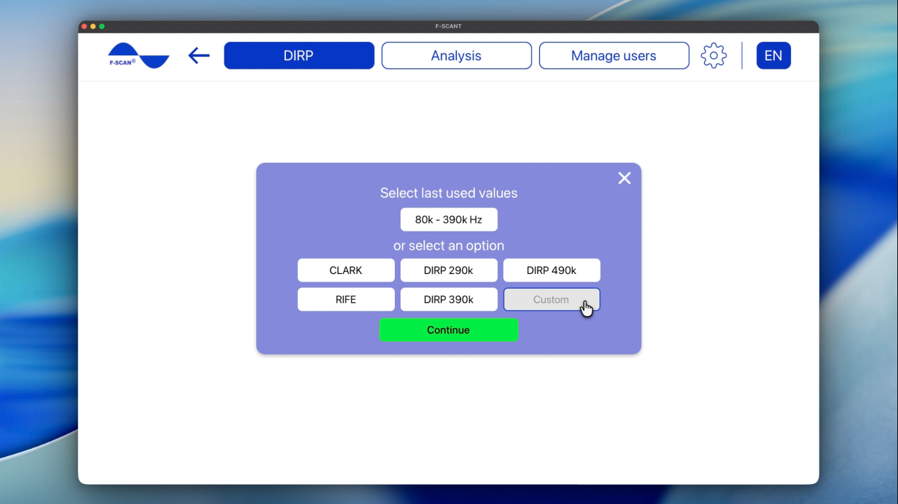

# Come creare o importare un DIRP

**Needs F-SCAN**

DIRP sta per Dual Integration Resonance Procedure ed è, in sostanza, una scansione su un intervallo di frequenze. L’F-SCAN invia ciascuna frequenza a turno e F-SCANT disegna un grafico delle risposte.

La scansione va da una frequenza inferiore (**Fmin**) a una superiore (**Fmax**), a passi di **Delta F**.

Dopo aver fatto clic su **Crea o importa DIRP** nella schermata iniziale, oppure su **DIRP** nella barra dei menu in alto, puoi scegliere come iniziare:

- **Avvia un nuovo DIRP:** esegui un nuovo DIRP da F-SCANT
- **Importa DIRP dal dispositivo:** importa un DIRP già presente sul dispositivo F-SCAN

Figura 6. Avvio DIRP: **Avvia un nuovo DIRP** o **Importa DIRP dal dispositivo**.

## Avviare un nuovo DIRP

1. Seleziona un utente, poi fai clic su **Continua**.
2. Seleziona un intervallo di frequenza, poi continua.
3. Fai clic su **Avvia** sul grafico DIRP.

### Selezionare un utente

**Seleziona utente** elenca le persone già memorizzate in F-SCANT. Fai clic su un nome, oppure su **Nuovo utente** per aggiungerne uno, poi **Continua**.

Video 4. Creare un nuovo utente, poi avviare un DIRP.

  <video controls preload="none" width="100%" src="/assets/videos/new-user-dirp.mp4">
  </video>
  

    <strong>Video 4.</strong> Creare un nuovo utente, poi avviare un DIRP. Guarda online:
    <a href="https://fscant-docs.fscan.com/it/dirp/">fscant-docs/it/dirp/</a>
  

### Selezionare un intervallo di frequenza

La schermata dell’intervallo offre:

- **Seleziona ultimi valori:** gli ultimi **Fmin**, **Fmax** e **Delta F** usati in F-SCANT (la prima volta: da 300 kHz a 450 kHz, a passi di 150 Hz)
- **oppure scegli un’opzione:** intervalli pronti **CLARK**, **RIFE**, **DIRP 290k**, **DIRP 390k**, **DIRP 490k**
- **Personalizzato:** digita i tuoi **Fmin**, **Fmax** e **Delta F**

**Fmin** è dove inizia la scansione. **Fmax** è dove termina. **Delta F** è lo scarto tra una frequenza e la successiva. Il campo **Modalità DIRP** mostra **AUTO** o **FAST** per quell’intervallo.

Nota: **Fmin** deve essere inferiore a **Fmax**. Puoi impostare **Fmin** da 50 Hz, **Fmax** fino a 2 MHz e **Delta F** da 1 Hz a 10 000 Hz. Se un valore è fuori da questi intervalli, F-SCANT mostra un errore. Correggi il numero per continuare.

Figura 7. Intervallo di frequenza: ultimi valori, preset e **Personalizzato**.

Video 5. Scegliere un intervallo di frequenza personalizzato.

  <video controls preload="none" width="100%" src="/assets/videos/custom-frequencies-selection.mp4">
  </video>
  

    <strong>Video 5.</strong> Scegliere un intervallo di frequenza personalizzato. Guarda online:
    <a href="https://fscant-docs.fscan.com/it/dirp/">fscant-docs/it/dirp/</a>
  

### Prima di avviare il DIRP

Prepara l’F-SCAN per un DIRP come nel manuale del dispositivo (sensore sull’uscita indicata sul dispositivo, persona collegata). F-SCANT avvia la scansione e memorizza il grafico. Non sostituisce la preparazione del sensore sul dispositivo.

### Eseguire un DIRP

Quando hai preparato il dispositivo, fai clic su **Avvia**.

Il grafico mostra la scansione da **Fmin** a **Fmax**:

- Le barre verdi sono le risposte a ciascuna frequenza (**MV** è l’altezza di ciascuna barra).
- La linea lilla è il livello di clipping (**Clip**). Le barre sopra questa linea contano come **HITS**.
- **CV** è una lettura di base per la persona.
- La funzione di zoom (− / +) rende le barre più alte o più basse per una lettura più facile. Non cambia quanti **HITS** ci sono.

Attendi che il grafico raggiunga **Fmax** e che lo stato mostri **Completato**. Il DIRP viene salvato automaticamente sia su F-SCANT sia sul dispositivo.

Video 6. Esecuzione di un DIRP in tempo reale.

  <video controls preload="none" width="100%" src="/assets/videos/live-dirp.mp4">
  </video>
  

    <strong>Video 6.</strong> Esecuzione di un DIRP in tempo reale. Guarda online:
    <a href="https://fscant-docs.fscan.com/it/dirp/">fscant-docs/it/dirp/</a>
  

Se vuoi un insieme diverso di **HITS**, puoi spostare il livello di clipping inserendo un valore tra 0 e 100 nelle impostazioni DIRP nel riquadro grigio a destra del grafico. Mentre usi F-SCANT, sposta il livello di clipping solo dal software (non dal dispositivo F-SCAN). Compare **Salva DIRP** quando il livello di clipping è diverso da quello già salvato.

Se interrompi la scansione prima di Fmax, un messaggio chiede se vuoi davvero interrompere. Fermarsi prima significa che la scansione è incompleta e F-SCANT non può salvare risultati parziali. Interrompi solo se vuoi scartare questo DIRP. Se preferisci tenerlo, scegli **Rimani** e la scansione continua.

Se passi a un altro menu dalla barra in alto mentre un DIRP è ancora in corso, avrai la stessa scelta. **Rimani** ti tiene sul grafico. **Interrompi** o **Esci** fanno uscire dalla scansione.
