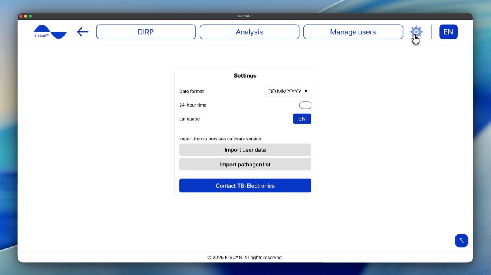

# Impostazioni

Fai clic sull’ingranaggio nel menu in alto per aprire **Impostazioni**.

Figura 10. **Impostazioni**: formato data, formato 24 ore, lingua e importazione.

## Come impostare data e ora

- **Formato data:** imposta l’ordine in cui vengono mostrate le date. Scegli **DD.MM.YYYY** (giorno prima, es. 25.10.2026), **MM.DD.YYYY** (mese prima, es. 10.25.2026) oppure **YYYY.MM.DD** (anno prima, es. 2026.10.25).
- **Formato 24 ore:** se attivo, le ore appaiono come 14:30. Se disattivo, appaiono come 2:30 PM.

Queste impostazioni cambiano solo come data e ora appaiono in F-SCANT. Non modificano l’F-SCAN.

## Come impostare la lingua

**Lingua** in **Impostazioni**, oppure le lettere della lingua nella barra in alto, cambiano la lingua di F-SCANT.

Il menu mostra **EN**, **IT**, **DE**, **PL**, **CZ** (inglese, italiano, tedesco, polacco, ceco).

Parole come DIRP, Hz, **Fmin**, **Fmax**, **HITS** e **CLIP** restano uguali in ogni lingua. Anche i nomi delle persone e l’elenco patogeni non vengono tradotti.

## Come importare da una versione precedente del software

Sotto **Importa da una versione precedente** puoi portare dati da software F-SCANT più vecchio:

- **Importa dati utente**
- **Importa lista patogeni**

Per ciascuno, fai clic su **Scegli file** e seleziona l’export del software precedente, oppure incolla il testo di quell’export dove lo schermo lo richiede. Lo schermo menziona un array JSON; è semplicemente il formato file del vecchio export.

**Nota:** l’importazione aggiunge o sostituisce dati su questo computer, a seconda del file. Controlla di avere il file corretto prima di continuare. Questo non modifica ciò che è memorizzato sull’F-SCAN finché non trasferisci qualcosa.

## Contatta TB-Electronics

**Contatta TB-Electronics** apre un’email a info@fscan.com.
