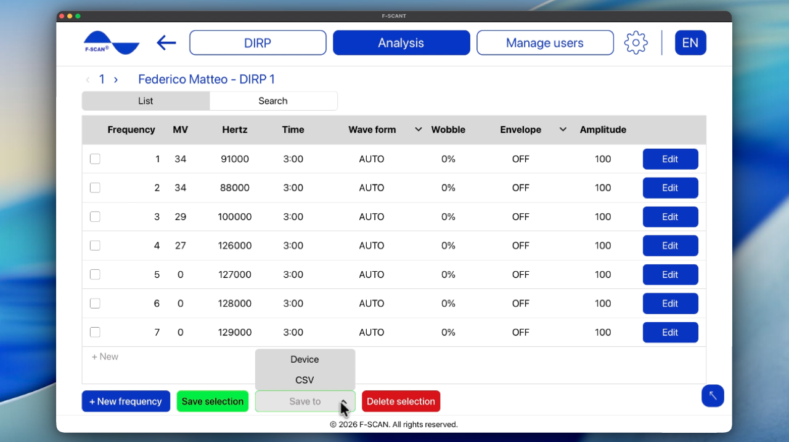

# Jak analizować DIRP

## Jak wczytać zapisany DIRP

1. Kliknij **Wczytaj DIRP** na ekranie głównym albo **Analiza** na górnym pasku.
2. Wybierz użytkownika, a następnie DIRP do analizy.
3. Otwiera się zapisany wykres.

Ten sam wykres możesz otworzyć z **Zarządzaj użytkownikami**, **Zarządzaj DIRP**, potem **Wczytaj DIRP**.

Jeśli widzisz **Wybierz użytkownika** lub **Wybierz DIRP**, nic jeszcze nie wybrano. Wybierz użytkownika i DIRP z list, potem kontynuuj.

Film 7. Otwarcie Analizy i wczytanie DIRP.

  <video controls preload="none" width="100%" src="/assets/videos/analysis-navigation.mp4">
  </video>
  

    <strong>Film 7.</strong> Otwarcie Analizy i wczytanie DIRP. Obejrzyj online:
    <a href="https://fscant-docs.fscan.com/pl/analysis/">fscant-docs/pl/analysis/</a>
  

Na wykresie **Dopasuj do katalogu** i **Otwórz program** korzystają z już zapisanego poziomu przycinania.

## Jak czytać wykres

Wykres jest taki sam jak podczas skanu na żywo:

- **CV** (Conductivity Value): osobista wartość bazowa analizowanego użytkownika. Dla użytecznych wyników powinna wynosić od 5% do 25%.
- **MV** (Measured Value): jak silnie zarejestrowała się częstotliwość. Widać ją jako zielony słupek — im wyższy, tym silniejszy odczyt.
- **HITS:** słupki powyżej linii CLIP. To najsilniejsze wyniki skanu.
- **ZOOM:** użyj +, aby wykres był wyższy, i −, aby był niższy. Podnieś go, gdy słupki są za małe, obniż, gdy są za duże.
- **CLIP** / **Poziom przycinania:** linia decydująca, które słupki liczą się jako **HITS**. Po zakończeniu skanu **AUTO** ustawia ją za Ciebie. Jeśli chcesz więcej lub mniej HITS, przesuń linię w dół lub w górę.

Strzałki obok numeru DIRP otwierają poprzedni lub następny zapisany DIRP tego użytkownika.

## Jak dopasować HITS do katalogu częstotliwości

**Dopasuj do katalogu** porównuje Twoje HITS z katalogiem częstotliwości zapisanym w F-SCANT. Dla każdej pozycji katalogu sprawdza, czy jej częstotliwość mieści się w zakresie dopasowania któregoś z Twoich HITS. Jeśli tak, pozycja pojawia się w tabeli jako dopasowanie z katalogu.

**Zakres dopasowania ± Hz** określa, jak blisko muszą być częstotliwości, żeby uznać je za dopasowanie. Typowy zakres to 1000 Hz. Szerszy zakres daje więcej dopasowań, węższy — mniej. Zakres możesz zmienić na ekranie wyników (nie w **Ustawienia**).

Aby zobaczyć dopasowania:

1. Otwórz zapisany **DIRP** albo dokończ nowy.
2. Kliknij **Dopasuj do katalogu**.
3. Przeczytaj tabelę. Zmień **Zakres dopasowania ± Hz**, jeśli chcesz szerszy lub węższy zakres.
4. Wybierz, co dalej:
    - **Eksportuj** zapisuje arkusz CSV.
    - **Otwórz katalog częstotliwości** pozwala przeglądać pełny katalog. Możesz szukać po nazwie, sortować od A do Z lub według częstotliwości. Zaznaczone wiersze można dodać do tabeli analizy przyciskiem **Dodaj do analizy**.
    - **Zapisz program** tworzy i zapisuje program na podstawie zaznaczonych wierszy.

**Uwaga:** tabela wyników zawiera tylko pozycje katalogu, których częstotliwość jest bliska Twoim HITS. Nie jest diagnozą medyczną.

Film 8. Dopasowanie HITS do katalogu i przeglądanie katalogu częstotliwości.

  <video controls preload="none" width="100%" src="/assets/videos/pathogens.mp4">
  </video>
  

    <strong>Film 8.</strong> Dopasowanie HITS do katalogu i przeglądanie katalogu częstotliwości. Obejrzyj online:
    <a href="https://fscant-docs.fscan.com/pl/analysis/">fscant-docs/pl/analysis/</a>
  

## Jak otworzyć i zapisać program

**Program** to lista częstotliwości wzięta z **HITS** DIRP (przebieg, czas, Wobble, obwiednia i amplituda). Zmiana programu nie zmienia oryginalnego wykresu DIRP.

1. Otwórz program na jeden z dwóch sposobów: kliknij **Otwórz program** na wykresie DIRP po zakończeniu DIRP albo użyj **Zarządzaj programem** w **Zarządzaj użytkownikami**.
2. W razie potrzeby edytuj wiersze. Możesz zmienić Przebieg, Czas, Wobble, Obwiednię i Amplitudę. Kliknij **+ Nowa częstotliwość**, aby dodać wiersz.
3. Kliknij **Zapisz do** i wybierz miejsce zapisu:
    - **CSV** zapisuje wybrane częstotliwości jako plik arkusza.
    - **Urządzenie** wysyła program na F-SCAN (**Needs F-SCAN**). F-SCANT nie uruchamia programu na urządzeniu. Naciśnij START na F-SCAN, gdy chcesz go uruchomić.

Rysunek 8. Lista programu z **Zapisz do** **Urządzenie** i **CSV**.

