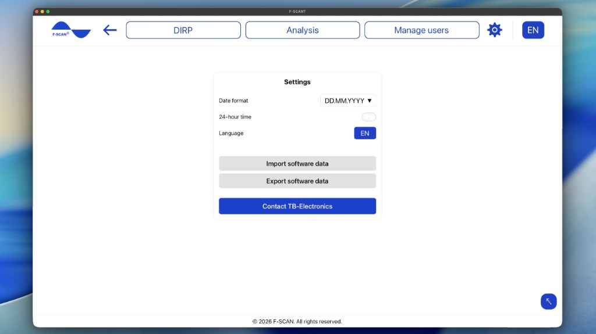

# Ustawienia

Kliknij koło zębate w górnym menu, aby otworzyć **Ustawienia**.

Rysunek 10. **Ustawienia**: format daty, format 24-godzinny, język, **Importuj dane oprogramowania** i **Eksportuj dane oprogramowania**.

## Jak ustawić datę i godzinę

- **Format daty:** ustawia kolejność wyświetlania dat. Wybierz **DD.MM.YYYY** (dzień najpierw, np. 25.10.2026), **MM.DD.YYYY** (miesiąc najpierw, np. 10.25.2026) lub **YYYY.MM.DD** (rok najpierw, np. 2026.10.25).
- **Format 24-godzinny:** gdy jest włączony, godziny pojawiają się jako 14:30. Gdy jest wyłączony — jako 2:30 PM.

Te ustawienia zmieniają tylko wygląd dat i godzin w F-SCANT. Nie zmieniają F-SCAN.

## Jak ustawić język

**Język** w **Ustawienia** albo litery języka w górnym pasku zmieniają język F-SCANT.

Menu pokazuje **EN**, **IT**, **DE**, **PL**, **CZ** (angielski, włoski, niemiecki, polski, czeski).

Słowa takie jak DIRP, Hz, **Fmin**, **Fmax**, **HITS** i **CLIP** pozostają bez zmian w każdym języku. Nazwiska osób i nazwy w katalogu częstotliwości też nie są tłumaczone.

## Jak importować i eksportować dane oprogramowania

**Importuj dane oprogramowania** wczytuje do F-SCANT użytkowników, DIRP i katalog częstotliwości z dowolnej wersji oprogramowania.

1. Kliknij **Importuj dane oprogramowania**.
2. Wybierz jeden lub więcej plików, co najwyżej 50: kopię F-SCANT (`.json`) albo plik F-SCANT3 (`.ft3`).
3. Wybierz **Dodaj tylko brakujące pozycje** lub **Dodaj wszystko (zmień nazwy kopii)**. Pozycje katalogu o tej samej nazwie i częstotliwości nigdy nie są duplikowane.
4. Podsumowanie pokazuje, co zostało zaimportowane, i wymienia pliki, których nie udało się zaimportować.

**Eksportuj dane oprogramowania** zapisuje użytkowników, DIRP i katalog częstotliwości z tego komputera w jednym pliku kopii.

**Uwaga:** import dodaje dane na tym komputerze. Sprawdź, czy masz właściwe pliki, zanim kontynuujesz. To nie zmienia tego, co jest zapisane na F-SCAN, dopóki czegoś nie prześlesz.

## Kontakt z TB-Electronics

**Kontakt z TB-Electronics** otwiera wiadomość e-mail na adres info@fscan.com.
