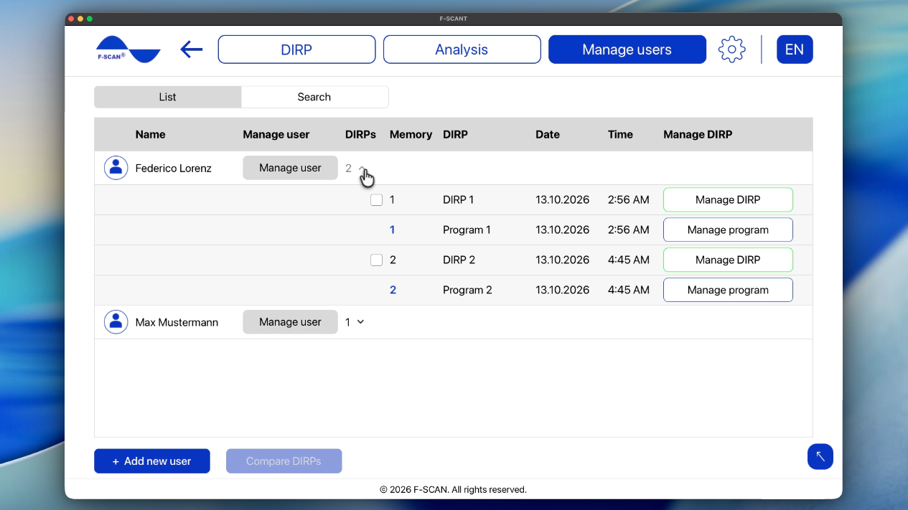

# How to manage users

A **user** in F-SCANT is a person you keep DIRP results for. It is not a login or a password.

**Manage users** lists everyone stored in F-SCANT, with **Name**, **DIRPs**, **Memory**, **Date** and **Time**. Open a row to see that person’s DIRPs and program.

Figure 15. **Manage users**, one row expanded.

## Adding and finding users

- **Add new user:** type a name and click **Add**.
- **Search:** type a name and confirm with the search control. The list does not filter while you type; you need to confirm the search.

You can also add a person with **New user** when you start a DIRP.

If you see **A patient with this name already exists.**, that name is already in your list. F-SCANT can’t save two users under the same name, so choose a different name, for example by adding a middle initial or number.

## Renaming or deleting a user

Select a user and click **Manage user**.

- **Edit name:** type the new name.
- **Delete user:** When you delete a user, F-SCANT asks you to confirm. Deleting means the person and all of their DIRPs and programs will be removed from F-SCANT, and this can’t be undone. If you’re sure, click **DELETE**.

## Managing a users’ DIRP or program

On an open user row:

**Manage DIRP**

- **Load DIRP:** opens the DIRP chart (see [How to analyze a DIRP](analysis.md)).
- **Analyze pathogens:** opens pathogen matching for that DIRP.
- **Remove DIRP from this user:** deletes that DIRP from F-SCANT for this user.
- **Change memory location:** sets a memory number from 1 to 100 for this user.

**Manage program**

- **Open program:** opens the frequency list.
- **Remove program from this user:** deletes the program (but not the corresponding DIRP).
- **Change memory location:** sets a memory number from 1 to 100.

To send a DIRP or a program to the device, use **Transfer DIRP to device** or **Save to** **Device** (see [create or import a DIRP](dirp.md) and [analyze a DIRP](analysis.md)).

## Comparing two DIRPs

1. Open **Manage users**.
2. Select two DIRPs.
3. Click **Compare DIRPs**.

If nothing happens when you click **Compare DIRPs**, check that exactly *two* DIRPs are selected.

The comparison opens as a graph. **Switch to program** and **Switch to DIRP** change the display. **Export** saves both DIRPs together into one **CSV** spreadsheet.

Figure 16. Managing users.

<video controls width="100%" src="assets/videos/dirp-comparison.mp4">
  Your browser does not support the video tag.
</video>

## Changing a memory location

Each user can have memory numbers 1 to 100 in F-SCANT. These numbers help you find a DIRP again. They are not the same as folders on your computer.

1. Click **Change memory location**.
2. Choose a number from 1 to 100.
3. If F-SCANT asks **REPLACE?** and tells you there is already something stored in this memory location, that number is already used for this user. Click **Replace** to overwrite what is there, or **Cancel** to keep the old item and pick another number.
